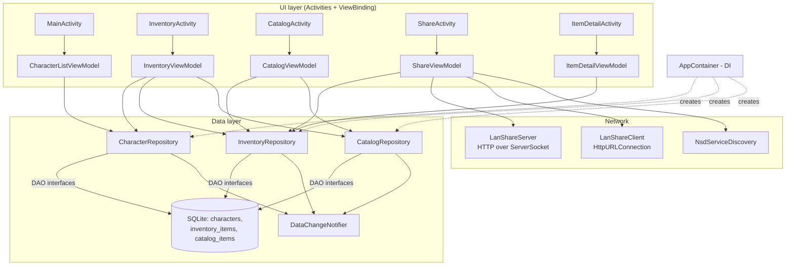
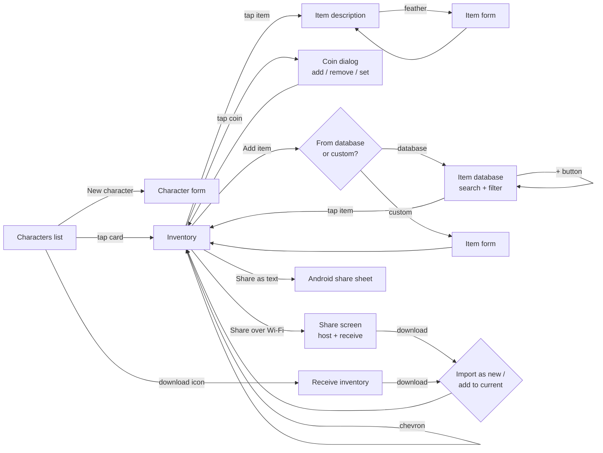

# Bag of Holding – D&D inventory companion

Android app for in-person Dungeons & Dragons sessions. Every player keeps several characters, each
with its own inventory, adds items in one tap from a built-in item database (or creates custom
items), and passes inventories to other players' phones over the local Wi-Fi network.

| | |
|---|---|
| Language | Kotlin |
| Min SDK / Target SDK | 24 (Android 7.0) / 36 |
| Architecture | MVVM + Repository + manual dependency injection |
| Local database | SQLite (`SQLiteOpenHelper`, no ORM) |
| UI | Material 3, light and dark theme, English and Bulgarian |
| Extra features | LAN sharing over HTTP + Network Service Discovery, Share Intent |

---

## 1. Idea

At the table, players track equipment on paper sheets that get messy: crossed-out arrows, coins
added up in the margins, forgotten weights. When an item is handed to another player, both sheets
need fixing. Bag of Holding replaces the paper inventory:

* several characters per phone, each with an independent inventory and a purse with all five
  coin types (pp / gp / ep / sp / cp);
* "+" and "−" buttons on every item for fast changes during combat;
* items can be held and dragged into any order, and put into **storage compartments** (backpack,
  belt, sack, Bag of Holding…) that can be folded shut to hide their contents;
* magic items are written in blue, and the more an item stack is worth, the more golden its row;
* 115 built-in items (weapons, armor, adventuring gear, tools, potions, magic items, treasure)
  based on the D&D 5e System Reference Document, plus the player's own custom items;
* automatic total weight, carrying capacity and encumbrance (5e variant rule, including the
  Powerful Build trait) and total value;
* sending a whole inventory to another phone on the same Wi-Fi, or as text to any app.

## 2. How it works

**Characters.** The start screen lists all characters with item count and total weight. The
"New character" button opens a short form: name, Strength and a **Powerful Build** checkbox
(goliaths, firbolgs… count as one size larger, so the carrying capacity is doubled). The ⋮ menu on a
card edits or deletes the character; deleting also removes its inventory (`ON DELETE CASCADE`).

**Inventory.** Tapping a character opens its inventory. The top card shows:

1. carried weight against the carrying capacity (Strength × 15 lb, × 2 with Powerful Build), an
   encumbrance label and a progress bar that turns red when the character is encumbered;
2. right under it, the **purse**: five coin tiles (pp, gp, ep, sp, cp). Tapping a coin opens a
   dialog to **Add**, **Remove** or **Set** that coin (e.g. "+150 gp" after a fight). Removing more
   coins than you have is refused. Coins are kept separately – nothing is exchanged automatically;
3. the total value of the items and the total worth of the purse.

* **+ / −** (faint, borderless buttons) change the quantity immediately. When the quantity reaches 0
  the item is removed and a snackbar offers **Undo**.
* **Hold and drag** any row to move it. The order is saved.
* **Storage compartments.** *Add item → Add a storage compartment* creates one (name, weight,
  price, how many pounds it holds, "contents weigh nothing", description, notes). Adding a
  Backpack, Sack, Pouch or Bag of Holding from the database creates one automatically. A
  compartment is a header in the list: **every item below it, up to the next compartment, is
  inside it** (shown indented). Drag an item under a backpack to pack it; drag it above the first
  compartment to carry it loose. The header shows the item count and load (e.g. `12 / 30 lb`, red
  when overfilled). The **chevron** on the header hides the contents behind the compartment;
  a closed compartment is moved together with its contents. Deleting a compartment keeps its
  items (they move to the top). Bag of Holding contents do not count toward carried weight.
* **Colors.** Names of *Magic* items are blue (inventory, details and database). Item rows turn
  gradually golden with the stack's value: plain up to 1 gp, fully golden from 500 gp
  (logarithmic scale, `ValueTint`).
* **Swipe** an item left or right to delete it. A confirmation dialog appears first; *Cancel* puts
  the row back. After deleting, the snackbar still offers **Undo**.
* **Tap** an item to open its **description page**: category, quantity, weight and value (each and
  total), the description and the player's notes. For a compartment it shows how full it is and
  what is inside. The **feather button** (bottom right) opens the
  edit form; the toolbar has a delete button.
* **Add item → From the item database** opens the database screen. Search by name and filter by
  category with chips. **Tapping an item** adds it and returns to the inventory (a snackbar
  confirms it). **The "+" button** adds it and stays in the database, so several items can be
  added in a row. Adding an item the character already has increases the existing stack instead
  of creating a duplicate. The item's description is copied into the inventory.
* **Add item → Create a custom item** opens the item form. The checkbox
  "Also save to the item database" makes the item reusable for other characters.
* In the database screen, custom items can be edited or deleted with a long press; the toolbar
  "+" creates a new database item. Built-in items are protected.

**Sharing over Wi-Fi (LAN).**

1. Player A opens a character → **Share over Wi-Fi** → **Start sharing**. The phone starts a
   small HTTP server (port 47321, or a free port if busy), advertises it on the local network with
   Android NSD (mDNS service `_bagofholding._tcp`) and shows its address, e.g. `192.168.1.23:47321`.
2. Player B opens **Share over Wi-Fi** (from a character) or **Receive inventory** (download icon
   on the start screen). Phones that are sharing appear under "Nearby players" automatically; the
   address can also be typed by hand.
3. B taps the host. The app downloads `GET /inventory` (JSON) and asks whether to **import it as a
   new character** or **add the items to the current character**. When adding, items with the same
   name and category are stacked.

Sharing stops when the share screen is closed: the server socket is closed and the NSD
registration removed in `ViewModel.onCleared()`, so nothing keeps running in the background.

**Share as text.** The inventory menu has **Share as text**, which sends a plain-text summary via the
Android share sheet (Share Intent) to messengers, notes, e-mail, etc.

**Theme.** Start screen menu → **Theme** → follow system / light / dark (saved in SharedPreferences).

## 3. Architecture

MVVM with a repository layer and manual constructor injection (an `AppContainer` created in the
`Application` class, as described in the Android "Manual dependency injection" guide).



| Package | Contents |
|---|---|
| `data.model` | `PlayerCharacter`, `InventoryItem`, `CatalogItem`, `ItemCategory` |
| `data.dao` | DAO interfaces (`CharacterDao`, `InventoryDao`, `CatalogDao`) |
| `data.db` | `DatabaseHelper` (`SQLiteOpenHelper`), SQL schema, SQLite DAO implementations, built-in item list |
| `data.repository` | Repositories; expose `Flow`s and run all SQL on `Dispatchers.IO` |
| `domain` | Pure Kotlin logic: currency, encumbrance, list layout (compartments, drag & drop), value tint, merging, form validation, text export |
| `network` | JSON payload (kotlinx.serialization), HTTP server/client, NSD discovery |
| `di` | `AppContainer` |
| `ui.*` | Activities, ViewModels, RecyclerView adapters, dialogs (character, item, coin) |

Key decisions:

* **Plain SQLite with reactive updates.** SQLite has no observable queries, so every write calls
  `DataChangeNotifier.notifyChanged()` and every observed query is `notifier.changes.map { query }`.
  The UI updates automatically after any insert, update or delete.
* **ViewModels expose `StateFlow`**, collected with `repeatOnLifecycle(STARTED)`; one-off events
  (undo snackbars, errors) go through a `Channel`.
* **No Activity references in ViewModels**, dialogs are dismissed in `onDestroy`
  (`AlertDialog.dismissWith`), NSD uses the application context, and the server socket is closed
  in `onCleared()` – this prevents memory and window leaks.
* **Thread safety.** Fast taps on + / − are serialized with a `Mutex` in `InventoryRepository`.
* **Storage compartments without a tree.** Items and compartments live in one list ordered by
  `sort_order`; membership is derived from the order (`InventoryLayout.sections`). Drag & drop
  therefore only has to save a new order (`InventoryLayout.reorder`), and packing an item is the
  same gesture as reordering. While a drag runs, the adapter owns the order and ignores database
  updates; the new order is written once, on drop.
* **Schema version 3** (foreign keys enabled in `onConfigure`):

  ```
  characters(_id, name, strength, powerful_build, pp, gp, ep, sp, cp, created_at)
  catalog_items(_id, name, category, weight, cost_cp, description, is_custom,
                capacity, weightless_contents)
  inventory_items(_id, character_id → characters ON DELETE CASCADE, name, category, quantity,
                  weight, cost_cp, description, notes, catalog_id → catalog_items ON DELETE SET NULL,
                  sort_order, is_container, capacity, weightless_contents, collapsed)
  ```

* **Migrations.** `DatabaseHelper.onUpgrade` upgrades step by step with `ALTER TABLE` instead of
  deleting data. v1 → v2: the single `purse_cp` value is split into gp/sp/cp, inventory items
  receive the description of their database item. v2 → v3: items get a `sort_order` matching the
  old on-screen order, built-in bags get capacities, and owned bags become compartments.

### Course requirements → implementation

| Requirement | Where |
|---|---|
| Kotlin, minSdk 24, latest targetSdk | `app/build.gradle.kts` |
| 2+ screens with navigation (Intent) | 5 Activities: `MainActivity` → `InventoryActivity` → `ItemDetailActivity` / `CatalogActivity` (returns a result) / `ShareActivity` |
| Material 3, light + dark theme | `Theme.Material3.DayNight`, `values/colors.xml` + `values-night/colors.xml`, theme picker |
| Local DB (SQLite) | `data/db/DatabaseHelper.kt`, `SqliteDaos.kt` |
| Full CRUD via UI | Characters, inventory items and custom database items: create, read, update, delete |
| Data persists after restart | SQLite file `bag_of_holding.db` |
| Extra feature – network communication (REST-style HTTP) | `network/LanShare.kt`, `ServiceDiscovery.kt`, `ui/share/` |
| Extra feature – Share Intent | `InventoryActivity.shareAsText()` |
| MVVM + Repository + DI | `ui/*/…ViewModel.kt`, `data/repository/`, `di/AppContainer.kt` |
| Unit tests ≥ 15 % + Espresso test | `app/src/test/…` (80+ tests), `app/src/androidTest/…/MainScenarioTest.kt` |
| ktlint + detekt | Gradle plugins, `.editorconfig`, `config/detekt/detekt.yml` |

## 4. User flow



Typical session: create "Thorin, STR 16" → open inventory → in the database press + on Chain
mail and Rations (staying there), then tap Longsword to add it and return → during the game press −
on Rations each day → after the fight tap the gp coin and add 150 → tap the Longsword to read its
damage → hand a potion to a friend: share the inventory and the friend merges it into their
character.

## 5. Setup

Requirements: Android Studio (Narwhal or newer), JDK 17+, Android SDK 36.

```bash
git clone https://github.com/<your-account>/MobileApps2025-<faculty-number>.git
cd MobileApps2025-<faculty-number>
./gradlew assembleDebug          # build
./gradlew installDebug           # install on a connected device / emulator
```

Or open the folder in Android Studio and press **Run**.

Quality checks:

```bash
./gradlew testDebugUnitTest                  # unit tests
./gradlew createDebugUnitTestCoverageReport  # coverage → app/build/reports/coverage/test/debug/
./gradlew connectedDebugAndroidTest          # Espresso test (device or emulator required)
./gradlew ktlintCheck detekt                 # style checks (ktlintFormat fixes formatting)
```

Release APK:

```bash
./gradlew assembleRelease
cp app/build/outputs/apk/release/app-release.apk apk/app-release.apk
```

Without a `keystore.properties` file the release APK is signed with the debug key so it installs
anywhere. To sign with your own key, create `release.jks` and a `keystore.properties` in the
project root (both are git-ignored):

```properties
storeFile=release.jks
storePassword=...
keyAlias=...
keyPassword=...
```

### Trying LAN sharing

* **Two phones:** connect both to the same Wi-Fi (or one phone's hotspot). Phone A: character →
  Share over Wi-Fi → Start sharing. Phone B: Receive inventory → tap A in "Nearby players" (or type
  the address shown on A).
* **One device:** start sharing, then type `127.0.0.1:47321` in the receive field on the same
  screen.
* **Two emulators:** emulators cannot see each other directly. On emulator A start sharing, then on
  the computer run `adb -s emulator-5554 forward tcp:47321 tcp:47321`; on emulator B type
  `10.0.2.2:47321` (10.0.2.2 is the host computer as seen from an emulator).

Some guest / university Wi-Fi networks block traffic between devices ("client isolation"); a
phone hotspot always works.

## 6. Test accounts

None – the app has no login and no server. All data is stored locally on the device.

## 7. Screenshots

| Characters | Inventory | Item database | LAN sharing | Dark theme |
|---|---|---|---|---|
|  |  |  |  |  |

## 8. APK

[`apk/app-release.apk`](apk/app-release.apk) – installable release build.

## Permissions

| Permission | Why |
|---|---|
| `INTERNET` | Open the local HTTP server and connect to other phones on the LAN. The app never contacts the internet. |

Cleartext HTTP is allowed in `network_security_config.xml` because LAN addresses cannot use HTTPS
certificates and Android's domain config cannot match IP ranges.

## Credits

Item names, prices and weights come from the *System Reference Document 5.1* by Wizards of the
Coast, licensed under [CC BY 4.0](https://creativecommons.org/licenses/by/4.0/).
