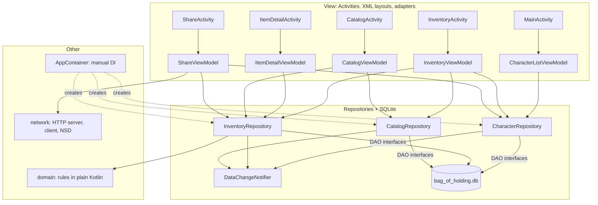
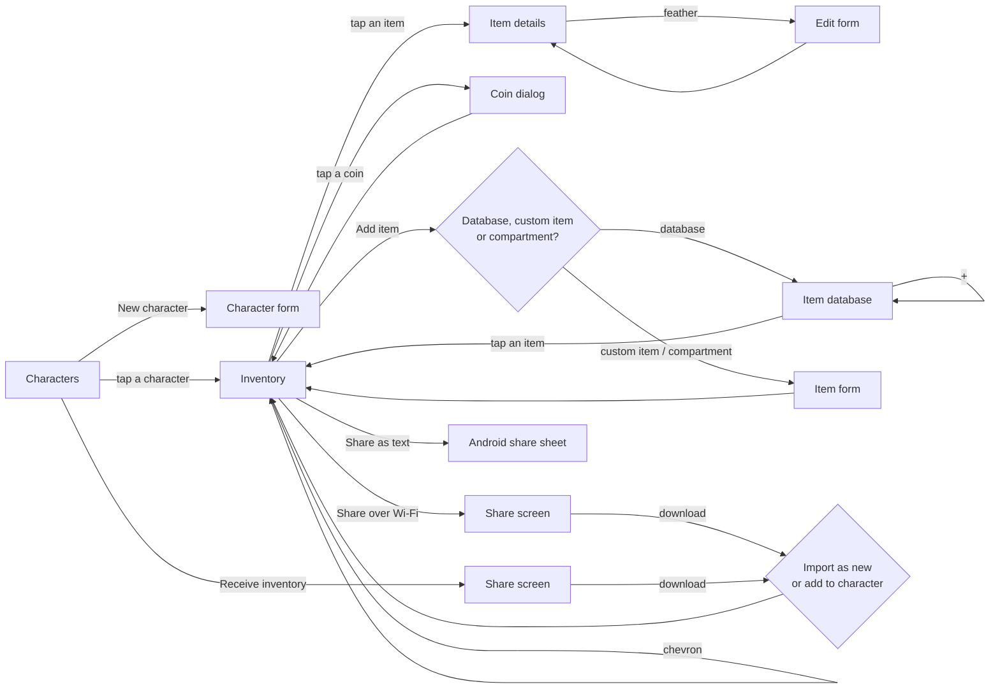

# Bag of Holding – Tabletop Inventory for D&D 5e

An Android app for in-person Dungeons & Dragons games. It replaces the paper inventory sheet:
each player keeps several characters on one phone, each with a purse and an ordered inventory
that can be packed into backpacks and other storage compartments, adds items from a built-in item
database in one tap, and passes inventories to other players' phones over the local Wi-Fi.

| | |
|---|---|
| Author | Boris Nedelchev, faculty number 2401321067 |
| Course | Mobile Applications |
| Version | 1.0 (database schema 3) |
| Platform | Android 7.0 (API 24) and newer |
| APK | [`apk/app-release.apk`](apk/app-release.apk) |

---

## 1. Idea

At the table, players track equipment on paper: crossed-out arrows, coins added up in the
margins, forgotten weights, and two sheets to fix every time an item changes hands. Bag of Holding
keeps that inventory on the phone:

- several characters per phone, each with its own inventory and a purse with all five coin types
  (pp, gp, ep, sp, cp);
- quick **+ / −** buttons on every item for changes during play;
- items can be held and dragged into any order and packed into **storage compartments**
  (backpack, belt, sack, Bag of Holding…) that fold shut to hide their contents;
- carried weight, carrying capacity and encumbrance (D&D 5e variant rule, with the Powerful Build
  trait) are calculated automatically, together with the value of the items;
- 115 built-in items from the D&D 5e System Reference Document, plus the player's own items;
- an inventory can be sent to another phone on the same Wi-Fi, or as text to any app.

---

## 2. Features

| Area | What the user can do |
|---|---|
| Characters | Create, edit, delete characters (name, Strength, Powerful Build). The list shows item count and carried weight. |
| Inventory | Weight bar with encumbrance, purse, item list with + / −, swipe to delete (with confirmation and Undo), hold and drag to reorder. |
| Storage compartments | Backpacks, belts, sacks, Bag of Holding: items listed under a compartment are inside it; the chevron hides them; load shown as e.g. `12 / 30 lb`. |
| Purse | Five coin tiles under the weight bar; tap one to add, remove or set coins. |
| Item details | Description page for an item or compartment; the feather button edits it, the bin deletes it. |
| Item database | 115 SRD items, search by name, filter by category. Tap an item to add it and return; tap **+** to add it and stay. Custom items can be created, edited and deleted. |
| Sharing | Share a character's inventory over Wi-Fi (phones find each other automatically) or as text through the Android share sheet. |
| Look | Material 3, square "blocky" style, light / dark / system theme, magic items in blue, valuable items in gold, English and Bulgarian. |

---

## 3. How it works

### Characters
The start screen lists every character, newest first, with the number of items and the carried
weight. **New character** opens a form with **name**, **Strength** (1–30) and a **Powerful Build**
checkbox (for goliaths, firbolgs and similar: they count as one size larger, so the carrying
capacity is doubled). The ⋮ menu on a character edits or deletes it; deleting also removes its
inventory. The menu at the top holds **Receive inventory** (download icon) and **Theme**.

### Inventory
Tapping a character opens its inventory. The card at the top shows, from top to bottom:

1. **Carried weight / carrying capacity** (Strength × 15 lb, × 2 with Powerful Build), a bar,
   and the encumbrance level. The bar and label turn red once the character is encumbered:
   - up to 5 × STR: unencumbered;
   - up to 10 × STR: encumbered;
   - up to 15 × STR: heavily encumbered;
   - above that: over capacity.
2. **The purse**: five tiles (pp, gp, ep, sp, cp). Tapping a coin opens a dialog with **Add**,
   **Remove** and **Set to** and an amount, e.g. "+150 gp" after a fight. Removing more coins than
   the character has is refused. Coins are kept separately; nothing is exchanged automatically.
3. **Value** of all items and the **total worth** of the purse.

Under the card is the item list:

- **+ / −** (faint, borderless) change the quantity at once. When it reaches 0 the item is
  removed and a message offers **Undo**.
- **Swipe** an item left or right to delete it. A confirmation dialog appears first; *Cancel* puts
  the row back. After deleting, **Undo** is still offered.
- **Hold and drag** a row to move it; the order is saved.
- **Tap** an item to open its description page (see below).
- **Add item** offers three choices: *From the item database*, *Create a custom item*, or
  *Add a storage compartment*.
- Names of **magic items are blue**. A row turns gradually **golden** with the value of the stack
  (price × quantity): plain up to 1 gp, fully golden from 500 gp.

### Storage compartments
A storage compartment is a row like a section heading. **Every item below it, down to the next
compartment, is inside it** and is shown indented; items above the first compartment are carried
loose.

- Drag an item under a backpack to pack it; drag it above the first compartment to take it out.
- The compartment row shows the number of items inside and the load (`12 / 30 lb`), in red when
  it is overfilled.
- The **chevron** on the right hides the contents behind the compartment, or shows them again.
  A closed compartment is dragged together with its contents; an open one moves alone.
- New items appear at the top (loose); new compartments at the bottom (empty).
- A compartment has a name, weight, price, how many pounds it holds (empty = no limit), a
  description, notes and a **Contents weigh nothing** option (Bag of Holding).
- Adding a Backpack, Sack, Pouch or Bag of Holding from the item database creates a compartment
  automatically.
- Deleting a compartment keeps its items: they move to the top of the list.

### Item details
Tapping an item opens its page: name (blue for magic items), category, quantity, weight and value
(each and in total), the description and the player's notes. For a compartment it shows how full it
is and lists what is inside. The **feather** button (bottom right) opens the edit form; the bin in
the toolbar deletes the item after a confirmation.

### Item database
**Add item → From the item database** opens 115 built-in items: weapons, armor, adventuring gear,
tools, consumables, magic items and treasure, with prices, weights and short descriptions.

- Search by name and filter by category with the chips at the top.
- **Tap an item** to add it and go back to the inventory; a message confirms it.
- **Tap +** to add it and stay, so several items can be added in a row.
- Adding an item the character already has increases the existing stack.
- The **+** in the toolbar creates a custom database item; filling in "Holds (lb)" makes it a
  storage compartment. Long-press a custom item to edit or delete it. Built-in items are
  protected.

### Sharing over Wi-Fi
1. Player A opens a character → **Share over Wi-Fi** → **Start sharing**. The phone starts a
   small HTTP server on port 47321 (another free port if it is busy), announces itself on the
   local network with Android Network Service Discovery and shows its address, e.g.
   `192.168.1.23:47321`.
2. Player B opens **Share over Wi-Fi** (from a character) or **Receive inventory** (start
   screen). Phones that are sharing appear under **Nearby players**; the address can also be typed.
3. B taps A. The inventory is downloaded as JSON (`GET /inventory`) and B chooses **Import as new**
   (a new character with its purse and items) or **Add to <character>** (loose items with the same
   name and category are stacked; received compartments are added at the bottom with their
   contents).

Sharing stops when the screen is closed: the server socket is closed and the network announcement
is removed.

**Share as text** in the inventory menu sends a plain-text summary through the Android share sheet
(messengers, notes, e-mail).

### Settings
Start screen → ⋮ → **Theme**: follow system, light or dark. The app is in English and switches to
Bulgarian when the phone's language is Bulgarian.

---

## 4. Architecture

MVVM with a repository layer and manual dependency injection.



- **View** (Activity + layout + adapter): draws the state it receives and forwards taps.
- **ViewModel**: holds the screen state as a `StateFlow`, survives screen rotation, starts work in
  `viewModelScope`.
- **Repository**: the only access to data; runs SQL on `Dispatchers.IO`. Every write calls
  `DataChangeNotifier`, and every observed query is re-run, so all screens update automatically.
- **DAO**: interfaces with SQLite implementations (`SqliteDaos.kt`) and in-memory fakes for tests.
- **Domain**: rules with no Android code (encumbrance, purse, storage compartments, merging,
  validation), easy to unit test.

| Package (`BagOfHolding/app/src/main/java/com/bagofholding/`) | Contents |
|---|---|
| `ui.characters`, `ui.inventory`, `ui.catalog`, `ui.share`, `ui.common` | Activities, ViewModels, adapters, dialogs, theme preference |
| `domain` | `InventoryCalculator`, `InventoryLayout`, `InventoryMerger`, `Currency`, `PurseRules`, `Validation` |
| `data.repository` | `CharacterRepository`, `InventoryRepository`, `CatalogRepository`, `DataChangeNotifier` |
| `data.dao`, `data.db` | DAO interfaces, `DatabaseHelper` (`SQLiteOpenHelper`), SQL schema, migrations, built-in items |
| `data.model` | `PlayerCharacter`, `Purse`, `InventoryItem`, `CatalogItem` |
| `network` | `LanShareServer`, `LanShareClient`, `NsdServiceDiscovery`, JSON format (`SharePayload`) |
| `di` | `AppContainer` |

### Database (SQLite, schema version 3)

```
characters(_id, name, strength, powerful_build, pp, gp, ep, sp, cp, created_at)
catalog_items(_id, name, category, weight, cost_cp, description, is_custom,
              capacity, weightless_contents)
inventory_items(_id, character_id → characters ON DELETE CASCADE, name, category, quantity,
                weight, cost_cp, description, notes, catalog_id → catalog_items ON DELETE SET NULL,
                sort_order, is_container, capacity, weightless_contents, collapsed)
```

- Prices are stored in copper pieces, weights in pounds per unit.
- Storage compartments are not a tree: items and compartments share one list ordered by
  `sort_order`, and an item belongs to the nearest compartment above it. Drag and drop only
  rewrites `sort_order`.
- `DatabaseHelper.onUpgrade` migrates older databases with `ALTER TABLE` instead of deleting data
  (v1 → v2: purse split into five coins, item descriptions; v2 → v3: ordering and compartments).

### Design decisions
- **Thread safety:** quick taps on + / − are serialized with a coroutine `Mutex`.
- **No memory leaks:** ViewModels never reference Activities, long-lived objects use the
  application context, open dialogs are dismissed in `onDestroy`, and data is collected only while
  the screen is visible (`repeatOnLifecycle`).
- **Versioned sharing format:** the JSON payload has a protocol version, so an older app refuses
  data from a newer one instead of misreading it.

---

## 5. Tech stack and dependencies

- **Language:** Kotlin 2.0.21
- **Persistence:** SQLite through `SQLiteOpenHelper` (no ORM), schema migrations
- **Lifecycle and architecture:** MVVM, `ViewModel` + `StateFlow`, Kotlin coroutines, Repository
  pattern, manual dependency injection
- **UI:** XML layouts with ViewBinding, Material 3 (Material Components 1.12.0), RecyclerView with
  `ItemTouchHelper` (drag and swipe), light and dark theme
- **Networking:** `ServerSocket` HTTP server, `HttpURLConnection` client, Network Service
  Discovery, kotlinx.serialization (JSON)
- **Min SDK:** 24 (Android 7.0)
- **Compile / Target SDK:** 36
- **Build:** Gradle 8.14.3, Android Gradle Plugin 8.11.1
- **Quality:** JUnit 4, kotlinx-coroutines-test, Espresso, ktlint, detekt

| Library | Version |
|---|---|
| androidx.core:core-ktx | 1.16.0 |
| androidx.appcompat:appcompat | 1.7.1 |
| com.google.android.material:material | 1.12.0 |
| androidx.activity:activity-ktx | 1.10.1 |
| androidx.lifecycle (viewmodel-ktx, runtime-ktx) | 2.8.7 |
| androidx.recyclerview:recyclerview | 1.4.0 |
| kotlinx-coroutines-android | 1.9.0 |
| kotlinx-serialization-json | 1.7.3 |

---

## 6. User flow



Example session: create "Thorin, STR 16" → open the inventory → add a Backpack from the database
(stays there with **+**), then tap Longsword to add it and return → drag Rations and Rope under
the Backpack and fold it shut → after a fight tap the gp coin and add 150 → tap the Longsword to
read its damage → share the inventory with a friend's phone.

---

## 7. Setup

Requirements: Android Studio (Narwhal or newer), JDK 17 or newer, Android SDK 36.

```bash
git clone https://github.com/BorisNedelchev/MobileApps2026-2401321067.git
cd MobileApps2026-2401321067/BagOfHolding
```

The Android project is in the **`BagOfHolding`** folder: open that folder in Android Studio
(**File → Open**), wait for Gradle sync and press **Run**. From the command line:

```bash
./gradlew assembleDebug          # build
./gradlew installDebug           # install on a connected phone or emulator
```

Checks (on Windows use `gradlew.bat`):

```bash
./gradlew testDebugUnitTest                  # 84 unit tests
./gradlew createDebugUnitTestCoverageReport  # coverage report: app/build/reports/coverage/test/debug/
./gradlew connectedDebugAndroidTest          # Espresso test (needs a phone or emulator)
./gradlew ktlintCheck detekt                 # style and static analysis
```

Release build:

```bash
./gradlew assembleRelease
```

Signing data is read from a `keystore.properties` file next to `settings.gradle.kts`; without it
the release APK is signed with the debug key. Keystores and `keystore.properties` are never
committed.

### Trying Wi-Fi sharing
- **Two phones:** both on the same Wi-Fi or on one phone's hotspot. Some university and guest
  networks block traffic between devices; a hotspot always works.
- **One phone:** start sharing, then type `127.0.0.1:47321` in the receive field on the same screen.
- **Two emulators:** start sharing on emulator A, run
  `adb -s emulator-5554 forward tcp:47321 tcp:47321` on the computer, and type `10.0.2.2:47321`
  on emulator B.

---

## 8. Test accounts

None. The app has no login and no server; all data is stored locally on the phone.

---

## 9. Screenshots

| Characters | Inventory | Wi-Fi sharing |
|---|---|---|
|  |  |  |

---

## 10. APK

[`apk/app-release.apk`](apk/app-release.apk): version 1.0, release build, about 5.3 MB.

To install: copy the file to an Android 7.0+ phone, open it and allow **Install unknown apps** for
the app you opened it with. If an older build signed with a different key is installed, uninstall
it first.

---

## 11. Course requirements

| Requirement | Where it is met |
|---|---|
| Kotlin, min SDK 24, latest target SDK | `BagOfHolding/app/build.gradle.kts` (min 24, target 36) |
| 2+ screens with navigation | 5 Activities linked with Intents; the item database returns a result to the inventory |
| Material 3, light and dark theme | `Theme.Material3.DayNight`, `values/` and `values-night/` colors, theme picker |
| Local database | SQLite (`SQLiteOpenHelper`), 3 tables, migrations |
| Full CRUD through the UI, data kept after restart | Characters, inventory items, storage compartments, custom database items |
| Extra feature | Network communication over the LAN (HTTP server + client + service discovery) and Share Intent |
| MVVM + Repository + DI | ViewModels, 3 repositories, `AppContainer` |
| Tests | 84 unit tests (rules, repositories, ViewModels, networking), 1 Espresso test of the main scenario |
| README, APK | This file, [`apk/app-release.apk`](apk/app-release.apk) |

---

## Permissions

| Permission | Why |
|---|---|
| `INTERNET` | Run the local HTTP server and connect to other phones on the LAN. The app does not contact the internet. |

Plain HTTP is allowed in `network_security_config.xml` because addresses on a local network cannot
use HTTPS certificates.

## Credits

Item names, prices and weights come from the *System Reference Document 5.1* by Wizards of the
Coast, licensed under [CC BY 4.0](https://creativecommons.org/licenses/by/4.0/).
